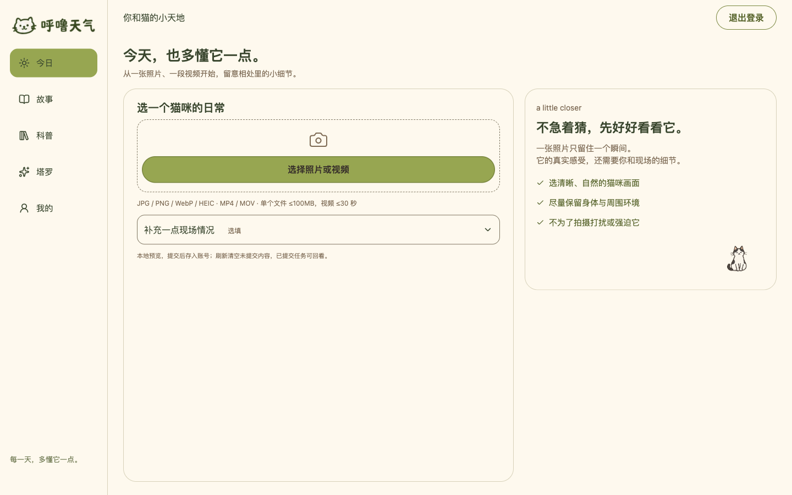
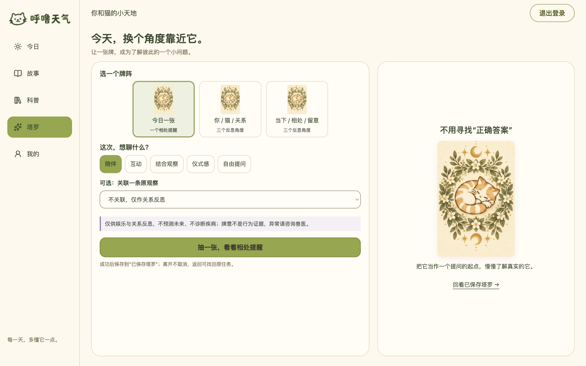
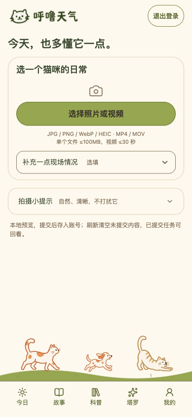
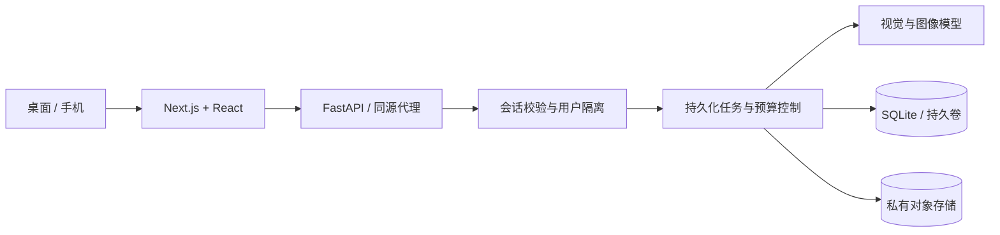

# 呼噜天气 · Hulu Weather

**每天，多懂它一点。**

从一张照片、一段视频开始，记录你和猫咪相处的小日常。

[体验说明](docs/DEMO.md) · [产品设计](docs/PRODUCT.md) · [技术实现](docs/ARCHITECTURE.md) · [使用与版权](COPYRIGHT.md)

> **面试体验版 · O2-1**：已完成本轮功能与界面验收。体验站按需开机，目前暂停服务；体验账号由维护者单独提供。下面的截图来自本地验收环境，不是实时在线状态。

### 从观察，到留下一段相处的记忆

猫咪不会直接告诉我们它的感受。呼噜天气希望帮助养猫者先看见画面中的线索，再结合现场情况理解它，并把相处过程保存下来。模型给出的观察有不确定性，趣味猫语和塔罗用于娱乐与关系反思，不能代替行为证据或兽医判断。

| 页面 | 可以做什么 |
| --- | --- |
| 今日 | 上传照片或短视频，补充现场情况，查看观察线索与互动建议 |
| 今日签 | 基于相处记录生成猫咪主题图片，文案独立展示，可再次回看 |
| 故事 | 按日期回看照片、视频和观察结果，下载原素材或删除记录 |
| 科普 | 浏览现有文章与相关内容；完整知识库与RAG链路仍在规划中 |
| 塔罗 | 选择一张或三张牌，进行关系反思，保存并按日期回看 |
| 我的 | 修改密码、查看容量、导出文字记录与媒体链接、管理账号 |

### 界面一览

| 桌面塔罗 | 手机今日页 |
| --- | --- |
|  |  |

奶油色与橄榄绿贯穿桌面、手机页面。桌面利用双栏展示操作与结果，手机优先保证上传、回看和底部导航可达。

### 这个项目重点解决了什么

- **结果可回看**：请求状态与结果持久化，离开页面后可找回原任务；回看不会重新生成。
- **账号有边界**：邀请账号、首次改密、服务端会话及用户数据隔离，前端不持有模型密钥。
- **失败可理解**：区分上传、模型、容量和连接失败，避免把未完成操作显示为成功。
- **费用有约束**：模型调用设置超时、有限重试、重复请求复用和预算保护；预算预留不等同于供应商实扣。
- **效果有证据**：自动化、模拟异常、真实模型样例与手机人工验收分开记录，不以“能运行”代替内容质量。

### 实现概览

前端采用 TypeScript；后端采用 Python、FastAPI 与 SQLAlchemy。完整源码保存在独立私有仓库，本仓库只展示产品与设计说明。当前云端为单实例部署，未宣称支持大规模并发或多实例高可用。详见[架构与限制](docs/ARCHITECTURE.md)。

### 验证与进度

O2-1验收包含23项正常操作、13项异常操作的证据索引；其中有模拟与注入测试，**不是36项全部使用真实模型验证**。阶段最后一轮前端测试140/140、后端v3相关测试11/11；这是已归档结果，并非本展示仓库刚执行的全量测试。

云端另验证了真实照片观察→今日签、塔罗、重复请求复用、账号隔离，以及服务重启后记录与媒体一致。成图质量仍受输入和模型影响，单个通过样例不代表所有图片都能稳定达标。[查看验证边界](docs/VALIDATION.md)

- 已完成：O2-1页面优化、基础功能复测、今日签样例修复与验收。
- 后续：O2-2A行为知识库与检索、O2-2B完整RAG结果链路、O2-3其余UI优化。

### 体验与交流

面试官可先阅读[三分钟体验路线](docs/DEMO.md)，再联系向你提供本项目链接的人申请独立账号。体验站需由维护者开机，无法打开时请先确认开放时间。

本仓库公开产品说明和界面截图，完整源码保存在私有仓库。公开展示不授予开源许可；原创文字、设计与素材的使用范围见[版权说明](COPYRIGHT.md)。
